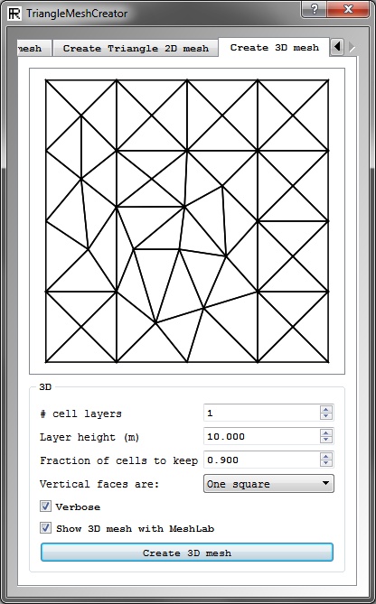

# TriangleMeshCreator

Create 3D meshes using Triangle for use by OpenFOAM.

TriangleMeshCreator is one of [Richèl Bilderbeek's tools](https://richelbilderbeek.github.io/tools/).

## Links

- [Source code](https://github.com/richelbilderbeek/TriangleMeshCreator)
- [Richèl Bilderbeek's tools](https://richelbilderbeek.github.io/tools/)
